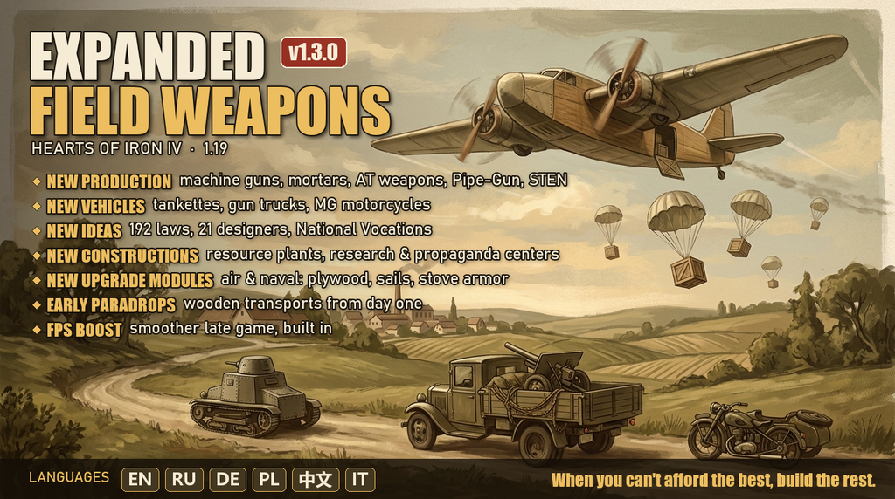
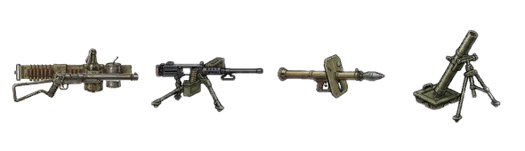
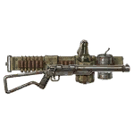
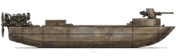
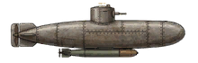
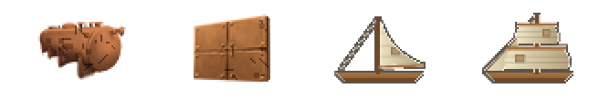
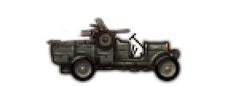
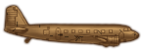
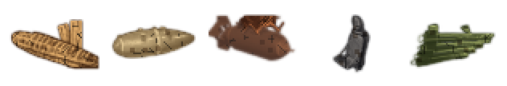
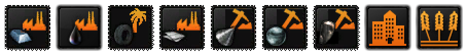

<div align="center">



# Expanded Field Weapons (EFW)

**Rendere utile anche ciò che una nazione può produrre quando non può permettersi il meglio.**

[](https://steamcommunity.com/sharedfiles/filedetails/?id=3801242021)


</div>

---

Mitragliatrici, mortai e anticarro prodotti a parte. Un fucile fatto con un tubo idraulico. Un caccia di compensato con la blindatura di una stufa. Navi a vela nel 1939.
E intorno, un intero sistema economico: edifici strategici, decisioni di mobilitazione e **192 nuove leggi** nel pannello politico.

EFW aggiunge scelte strategiche a Hearts of Iron IV **senza sostituire i sistemi vanilla**: usa i designer, gli scafi, gli airframe e le leggi del gioco e ci costruisce sopra.
Gran parte dei contenuti è pensata per il giocatore umano: l'IA non li usa, così il resto del mondo si comporta come in vanilla.

## Indice

| | | |
|---|---|---|
| 🔫 [Armi da campo](#-armi-da-campo) | 🪖 [Unità](#-unità) | 🔧 [Pipe-Gun Rifle](#-pipe-gun-rifle) |
| ⚓ [Navi improvvisate](#-navi-improvvisate) | 🪵 [Caccia in legno](#-caccia-in-legno) | 🏭 [Edifici](#-edifici) |
| 📜 [Decisioni](#-mobilitazione-e-investimenti-nazionali) | 📖 [Leggi](#-leggi-nel-pannello-politico) | 👔 [Designer e consiglieri](#-designer-e-consiglieri) |
| 🎯 [Vocazioni Nazionali](#-vocazioni-nazionali) | 🚢 [Invasioni Rapide](#-opzioni-militari-invasioni-rapide) | ⚡ [FPS e prestazioni](#-ottimizzazione-fps-e-prestazioni) |
| 👋 [Benvenuto](#-evento-di-benvenuto) | 📦 [Installazione](#-installazione) | 🧩 [Compatibilità](#-compatibilità) |
| 🛵 [Mezzi leggeri](#-mezzi-leggeri-improvvisati) | 🪂 [Aviotrasporto](#-aviotrasporto-improvvisato) | 🌍 [Lingue](#-lingue) |
| 📝 [Changelog](CHANGELOG.md) | | |

---

## 🔫 Armi da campo

<p align="center"></p>

EFW separa le armi pesanti della fanteria dalle normali Infantry Equipment e le trasforma in **tre linee di produzione dedicate**:

| Equipaggiamento | Costo | Risorse | Ruolo |
|---|---|---|---|
| **Mitragliatrici** | 1.00 IC | 1 acciaio | Fuoco automatico e soppressione: soft attack e difesa |
| **Mortai** | 1.20 IC | 1 acciaio | Fuoco indiretto contro bersagli morbidi e fortificazioni leggere |
| **Armi anticarro** | 1.40 IC | 1 acciaio, 1 tungsteno | Fucili anticarro, lanciatori e cariche: hard attack e perforazione |

<p align="center"><br><sub>Le tre nuove linee nella schermata produzione</sub></p>

Si sbloccano con **Support Weapons I**; Support Weapons II, III e IV danno bonus cumulativi alle nuove unità.
Il sistema cresce insieme alla normale ricerca della fanteria invece di aggiungere un albero tecnologico separato.

<details>
<summary><b>Statistiche base e progressione (V1.2)</b></summary>

```text
Mitragliatrici   Soft 9  | Hard 1  | Difesa 5 | Sfondamento 2 | Perforazione 4
Mortai           Soft 12 | Hard 2  | Difesa 2 | Sfondamento 4 | Perforazione 6
Armi anticarro   Soft 2  | Hard 11 | Difesa 2 | Sfondamento 1 | Perforazione 50

Support Weapons II   MG +10% soft/difesa, +5% sfondamento · Mortai +10% soft/sfondamento · AT +10% hard/perforazione
Support Weapons III  bonus analoghi
Support Weapons IV   MG +12% soft · Mortai +12% soft/sfondamento · AT +12% hard/perforazione
Infantry AT I e II   Compagnia AT +10% hard, +15% perforazione · Battaglione +4% hard, +8% perforazione
```

Dettagli in [`BALANCE_V1.2_IT.txt`](BALANCE_V1.2_IT.txt).
</details>

---

## 🪖 Unità

<p align="center"></p>

| Unità | Tipo | Equipaggiamento | A cosa serve |
|---|---|---|---|
| **Compagnia Supporto Mitragliatrici** | supporto | 30 Mitragliatrici · 220 uomini | Volume di fuoco senza sprecare un battaglione di linea |
| **Compagnia Supporto Mortai** | supporto | 18 Mortai · 190 uomini | Attacco contro fanteria e fortificazioni leggere |
| **Compagnia Supporto Anticarro di Fanteria** | supporto | 20 Armi AT · 180 uomini | Anticarro per la fanteria senza i battaglioni AT vanilla |
| **Battaglione Armi Pesanti** | linea, width 2 | 60 Fucili + 45 MG + 20 Mortai + 16 AT · 900 uomini | Reparto d'élite costoso ma versatile, per combattimenti prolungati |
| **Legionari dell'Impero** | linea, width 2, solo giocatore | 150 Fucili + 8 MG · 1500 uomini | Grande battaglione di milizia: ottimo in difesa e repressione, fragile da verde e fortissimo quando è pienamente addestrato (120 giorni) |
| **Paracadutisti di Milizia** | linea, width 2, paracadutabile | 100 Fucili · 900 uomini | Paracadutisti di massa, non d'élite: fuori dal limite delle forze speciali, peso 0,35. Vedi [Aviotrasporto](#-aviotrasporto-improvvisato) |

Le unità usano i modelli 3D vanilla (`infantry`, `artillery`, `anti_tank`), quindi sulla mappa e in battaglia non compaiono mai "buchi".
Le compagnie di supporto hanno `priority = 0`, come quelle vanilla, e non decidono il modello della divisione.

---

## 🔧 Pipe-Gun Rifle



Un tubo idraulico, un otturatore manuale, un calcio di tubo piegato e parecchio nastro isolante.
Il **Pipe-Gun Rifle** è un fucile improvvisato che si produce **senza risorse strategiche** ed è disponibile **dal primo giorno**.

Non vincerà la guerra, ma tiene una trincea: difesa alta, attacco basso e un'affidabilità che è meglio non controllare.

```text
Costo 0.12 IC | Acciaio 0 | Soft 4 | Hard 0.8 | Difesa 18 | Sfondamento 2 | Affidabilità 70%
```

Ideale per guarnigioni, porti, unità di seconda linea, ultime resistenze disperate e nazioni minori senza acciaio.

### Mitra STEN

Il gradino successivo: un tubo d'acciaio, un caricatore infilato di lato e un calcio di fil di ferro. Costa poco più del Pipe-Gun e spara molto meglio, ma rende meno in difesa dei fucili veri. Anche lui è disponibile **dal primo giorno**.

| | Pipe-Gun Rifle | **STEN** | Fucile base vanilla |
|---|---|---|---|
| Costo | 0,12 IC, 0 acciaio | **0,25 IC, 1 acciaio** | 0,43 IC, 2 acciaio |
| Attacco soft / hard | 4 / 0,8 | **5,5 / 0,8** | 3 / 0,5 |
| Difesa / sfondamento | 18 / 2 | **17 / 4** | 20 / 2 |
| Affidabilità | 70% | **78%** | 90% |

<p align="center"><br><sub>"Capace di essere prodotto con quasi nessuna risorsa." (tooltip in gioco, versione precedente delle statistiche)</sub></p>

---

## ⚓ Navi improvvisate

<p align="center">
  
  &nbsp;&nbsp;
  
</p>

Per le nazioni senza grandi cantieri: la **Motovedetta Improvvisata** (scafo `ship_hull_light_1`) e il **Sommergibile Tascabile Monoposto** (scafo `ship_hull_submarine_1`).

Sono varianti di scafi vanilla, quindi funzionano come navi normali in tutto e per tutto: Naval Designer, nomi, missioni, flotte, esperienza e supremazia navale.

<p align="center"><br><sub>Serbatoio ausiliario improvvisato · scafo carenato · vela piccola · vela grande</sub></p>

Sì, le vele. Nel 1939. Il carburante costa, il vento no.

<p align="center"></p>

---

## 🛵 Mezzi leggeri improvvisati

<p align="center">
  
  &nbsp;&nbsp;
  
</p>

Tre mezzi economici per chi non ha l'industria per i carri veri. Sono archetipi autonomi come le autoblindo vanilla: **non serve il designer dei carri** e funzionano con o senza DLC.

| Mezzo | Unità | Costo a battaglione | Ruolo |
|---|---|---|---|
| **Carro Veloce EFW** (mini carro) | Battaglione Carri Veloci · 40 mezzi · width 2 | 128 IC (un battaglione di carri leggeri ne costa 400-500) | Sfondamento 20, attacco 12, corazza 12: più della perforazione della fanteria del 1936, quindi prende il bonus corazza contro chi non ha anticarro. Ma *qualsiasi cannone anticarro lo apre come una scatoletta di sardine* |
| **Moto Mitragliera EFW** (side-car con MG) | Compagnia Motociclisti Mitraglieri · supporto | 15 moto (18 IC) + 20 fucili | Ricognizione (recon 1,5) che costa meno di quella motorizzata e dà **+5% attacco a tutta la fanteria** della divisione. Occupa lo slot della ricognizione |
| **Autocannone Improvvisato EFW** (furgone con cannone) | Batteria Autocannoni · 12 mezzi · width 2 | 48 IC, niente camion a parte | Artiglieria e anticarro nello stesso mezzo: attacco 22, perforazione 45, veloce come i motorizzati, nessuna corazza. *Legati insieme con molta corda e un po' di fede* |

Sono **disponibili dal primo giorno per tutte le nazioni**, come il Pipe-Gun Rifle: niente ricerca da aspettare. L'IA non li usa nei suoi template. L'icona del furgone è generata da [`make_gun_truck_icon.py`](utility/efw_vehicle_icons/make_gun_truck_icon.py), che compone un cannone anticarro e un camion vanilla; la moto usa l'icona vanilla della moto con side-car.

---

## 🪂 Aviotrasporto improvvisato

<p align="center"></p>

Nel gioco base i lanci di paracadutisti arrivano tardi: le nazioni minori non hanno il trasporto aereo e i paracadutisti d'élite sono limitati dal tetto delle forze speciali. EFW rende possibile un'invasione aerea già nel 1936-37. L'IA non usa questi contenuti.

| Contenuto | Cosa fa |
|---|---|
| **Trasporto vanilla per il giocatore** | Il trasporto aereo vanilla è disponibile **dal primo giorno** anche per le nazioni minori, che normalmente non lo hanno a inizio partita |
| **Trasporto in Legno EFW** | Versione rudimentale del trasporto vanilla, disponibile dal primo giorno per tutti. Lancio di paracadutisti e **rifornimento aereo** |
| **Paracadutisti di Milizia** | Battaglione paracadutabile **non d'élite**: non conta nel limite delle forze speciali e si può produrre in massa. Più debole (organizzazione 45 invece di 70), addestramento 90 giorni, peso 0,35 |
| **Compagnia MG EFW** | Ora è paracadutabile, come mortai e anticarro EFW |

| | Trasporto vanilla | Trasporto in Legno EFW |
|---|---|---|
| Costo | 38 IC | **16 IC** |
| Risorse | 3 alluminio, 2 gomma | 1 acciaio, 1 gomma |
| Affidabilità | 80% | **55%** |
| Raggio / velocità | 1000 km / 400 | 1000 km / 340 |
| Agilità / difesa | 10 / 20 | 9 / 16 |

### Quanti aerei servono?

Una divisione si può lanciare solo se **tutti** i suoi battaglioni e compagnie sono paracadutabili. Il gioco chiede un minimo di trasporti nella base di partenza: EFW lo abbassa da 50 a **25** (`MIN_PLANE_COUNT_PARADROP` in `common/defines/zzz_efw_gameplay_defines.lua`, vale per tutti i paesi). Con i Trasporti in Legno fanno circa **400 IC**, contro circa 950 IC di trasporti vanilla. Serve anche il **70% di superiorità aerea** sulla zona di lancio.

---

## 🪵 Caccia in legno


L'**EFW Wooden Fighter** è una variante dell'airframe vanilla `small_plane_airframe_0` con il modulo speciale **Telaio in Legno e Compressore Overboost**.

```text
✔ costo inferiore      ✔ peso ridotto       ✔ buona agilità       ✔ autonomia migliorata
✘ affidabilità bassa   ✘ protezione ridotta
```

Nello slot speciale piccolo dell'Air Designer trovi anche altri moduli "da officina":

<p align="center"></p>

| Modulo | Nome |
|---|---|
| `efw_wooden_boost_airframe` | Telaio in Legno e Compressore Overboost |
| `efw_improvised_drop_tank` | Serbatoio Ausiliario in Carta Pressata |
| `efw_multirole_combat_rack` | Rastrelliera d'Armamento Polivalente da Campo |
| `efw_cast_iron_stove_armor` | Blindatura Improvvisata "Stufa da Campo" |
| `efw_bazooka_charlie_tubes` | Tubi Lanciarazzi "Bazooka Charlie" |

<p align="center"><br><sub>8.25 IC di caccia. Il cuoco rivuole la sua stufa.</sub></p>

---

## 🏭 Edifici

<p align="center"><br><sub>Acciaio · petrolio · gomma · alluminio · tungsteno · cromo · carbone · Case Popolari · Campi di Grano</sub></p>

### Edifici strategici

<p align="center"><br><sub>Propaganda · Lavoro · Logistica e Difesa Civile · Ricerca</sub></p>

Massimo **1 per stato**. I bonus nazionali si sommano, ma Propaganda, Lavoro e Ricerca hanno un **costo crescente** e ognuno ha un **malus a tema**: i primi sono economici, coprire una grande nazione diventa molto caro.

| Edificio | Costo | Bonus (per edificio) | Malus |
|---|---|---|---|
| **Centro di Propaganda e Mobilitazione** | 1000 + 1500 per ogni Centro già posseduto, senza slot | +3.6% PP, +0.5% stabilità e supporto alla guerra, +1.2% popolazione reclutabile | −0.5% ricerca (censura), −2.4% resistenza locale |
| **Direzione del Lavoro Nazionale** | 1600 + 2000 per ogni Direzione già posseduta, usa uno slot | +4.8% produzione, +3.6% costruzione, +3.6% crescita efficienza, +6% risorse locali | −3% crescita popolazione, −0.4% stabilità |
| **Centro Nazionale di Ricerca** | 3000 + 1000 per ogni Centro già posseduto, usa uno slot | +3% ricerca, +1.2% efficienza iniziale delle nuove linee | +0.5% beni di consumo |
| **Centro Logistico e Difesa Civile** | 2200, senza slot | +0.40 rifornimenti, +12% infrastrutture/ferrovie/snodi, +6% costruzione nello stato | nessuno (effetti solo locali) |

> Il calo di stabilità della Direzione del Lavoro si compensa con i Centri di Propaganda. Le combinazioni sono il punto.

### Edifici delle risorse

**Un solo edificio per risorsa**, con valori a metà tra una piccola miniera e un grande impianto.
Niente slot di costruzione, massimo 5 livelli per stato (carbone: 10).

| Edificio | Produzione per livello |
|---|---|
| Acciaieria Integrata · Complesso Petrolifero · Piantagione di Gomma · Impianto di Alluminio | +30 |
| Miniera di Tungsteno · Miniera di Cromo | +18 |
| Miniera di Carbone | +25 |

Costo 5500 + 3500 per livello aggiuntivo (carbone: 1000 + 2000). La produzione non cresce con la ricerca.

### Edifici civili

| Edificio | Effetto | Limiti |
|---|---|---|
| **Case Popolari** | +10% manpower locale, +10% popolazione reclutabile | usa uno slot, 1 per stato |
| **Campi di Grano** | Autonomia alimentare. Per ogni stato: **−1% beni di consumo**, +0.2% stabilità, +2% crescita della popolazione (10 stati = −10% beni di consumo, +2% stabilità, +20% popolazione). Nello stato: +3 slot (+2 netti), +0.25 rifornimenti, +5% manpower | 1 per stato |

La vista stato vanilla ha posto per soli 5 edifici senza slot: EFW la porta a **3 righe da 5**, così si vedono tutti.

---

## 📜 Mobilitazione e Investimenti Nazionali

<p align="center"></p>

Una categoria di decisioni, visibile solo al giocatore. La regola è sempre la stessa: **un beneficio subito**, pagato con Political Power, manpower, treni e camion, che spesso vengono restituiti a fine programma.

| Decisione | Costo | Effetto |
|---|---|---|
| **Piano Industriale – Fase I** | 35 PP, 50k manpower, 5 treni, 200 camion | +8 civili e +2 militari offsite, +15% costruzione per 180 giorni. Sblocca la Fase II |
| **Piano Industriale – Fase II** | 35 PP, 50k manpower, 5 treni, 200 camion | +7 civili e +4 militari offsite, +15% costruzione per 180 giorni. Restituisce 10 treni, 400 camion e 50k manpower |
| **Grandi Opere e Piani Regolatori** | 50 PP, 60k manpower, 15 treni, 500 camion | +1 infrastruttura negli stati core sotto il livello 5, +2 slot negli stati core, +30% costruzione per 540 giorni. Risorse restituite |
| **Programma Navale Straordinario** | 40 PP, 50k manpower, 200 camion | +6 cantieri offsite permanenti. Manpower e camion restituiti dopo 1 anno |
| **Autarchia del Carburante** | 45 PP, 30k manpower | Per 365 giorni: +30% raffinerie sintetiche, +10% carburante, +2% beni di consumo. 30% di rischio di −2% stabilità. Ripetibile |
| **Obbligazioni Nazionali** | 0 PP | +120 PP subito, −180 PP dopo un anno, poi 90 giorni di cooldown. Ripetibile. *Paga dopo, piangi dopo.* |
| **Patto Sociale e Produzione Diffusa** | 40 PP, 5 treni, 300 camion | Per 3 anni: +500 manpower a settimana, +25% crescita demografica, +6% ricerca, +8% efficienza massima, +10% produzione militare, +4% beni di consumo |
| **Coordinare l'Economia Nazionale** | 75 PP | Richiede 2 Propaganda e 1 Lavoro. Idea permanente: +10% produzione militare e navale, +10% costruzione, +5% crescita efficienza, +5% supporto alla guerra, −2% stabilità |
| **Mobilitare la Nazione** | 100 PP | Richiede 4 Propaganda, 2 Lavoro, 1 Ricerca, 1 Logistica. +18% produzione militare, +15% navale, +20% costruzione, +12% crescita efficienza, +7.5% coscrizione e supporto alla guerra, −5% stabilità |

Le due decisioni di coordinamento accelerano anche la costruzione di Centri di Ricerca e Logistici (+35%).

---

## 🎯 Vocazioni Nazionali

Ogni nazione è brava in qualcosa. Nella categoria di decisioni **Vocazioni Nazionali** scegli **una sola** strada e la porti fino al terzo livello.
Ogni livello chiede **edifici EFW** e **leggi a tema**: chi fa combaciare edifici, leggi e vocazione ottiene un bonus enorme. Chi si specializza paga però un malus negli altri campi.

| Vocazione | Livello I (50 PP) | Livello II (100 PP) | Livello III (150 PP) | Malus |
|---|---|---|---|---|
| 🔬 **Repubblica degli Scienziati** | +10% ricerca | +22% ricerca | **+40% ricerca** | beni di consumo, produzione militare, supporto alla guerra |
| 🏭 **Officina della Nazione** | +6% produzione, +8% costruzione | +14% produzione, +15% costruzione, +10% crescita efficienza | **+28% produzione, +25% costruzione**, +20% crescita efficienza, +5% efficienza massima | ricerca, stabilità, popolazione |
| 🪖 **Nazione in Armi** | +3% attacco e difesa, −5% addestramento | +8% attacco e difesa, +3% coscrizione | **+16% attacco e difesa**, +5% organizzazione, +6% coscrizione, −20% addestramento, +15% esperienza | ricerca, beni di consumo, stabilità |
| ⚓ **Signori del Mare** | +6% produzione navale | +15% produzione navale, +6% danno e difesa navale | **+30% produzione navale**, +12% danno e difesa navale, +25% riparazioni e rimodernamenti | produzione militare, addestramento |
| 🔧 **L'Arte dell'Arrangiarsi** | −15% penalità per risorse mancanti | −35% penalità, +5% produzione | **−60% penalità**, +12% produzione, +20% efficienza iniziale, +10% risorse locali | ricerca, stabilità |

<details>
<summary><b>Requisiti di ogni livello</b></summary>

| Vocazione | Livello II | Livello III |
|---|---|---|
| Scienziati | 2 Centri di Ricerca, 4 slot di ricerca, una legge tra Borse di Studio / Università d'Eccellenza / Scambi Scientifici / Ricerca Militare | 4 Centri di Ricerca, 5 slot, Università d'Eccellenza o Scambi Scientifici, Borse di Ricerca o Città della Scienza |
| Officina | 2 Direzioni del Lavoro, Industria Pesante / Piano Quinquennale / Organizzazione Scientifica del Lavoro | 4 Direzioni del Lavoro, 2 Centri di Propaganda, Industria Pesante o Piano Quinquennale, Turni Lunghi / Mobilitazione del Lavoro / Corporativismo |
| Armi | 2 Centri di Propaganda, Armi Pesanti per Tutti / Squadre d'Assalto / Difesa in Profondità | 4 Centri di Propaganda, 2 Centri Logistici, una di quelle leggi, Scuola di Guerra / Stato Maggiore Generale / Quadri Veterani |
| Mare | 10 cantieri, Grandi Cantieri Navali / Marina d'Altura / Dottrina del Siluro / Arsenali di Rimodernamento | 25 cantieri, Grandi Cantieri Navali, Marina d'Altura / Dottrina del Siluro / Arsenali di Rimodernamento / Sistema dei Convogli |
| Arrangiarsi | **5.000 Pipe-Gun Rifle** in magazzino, Raccolta di Rottami o Materiali Surrogati | **20.000 Pipe-Gun Rifle** in magazzino, Raccolta di Rottami o Materiali Surrogati, Autarchia o Quote d'Importazione |

</details>

Tra un livello e l'altro passano **120 giorni**. Si può **rinnegare la vocazione** (25 PP), ma per 180 giorni arriva una *Crisi d'Identità Nazionale* (−5% stabilità, −20% PP) e non si può sceglierne un'altra.

> **Esempio:** 4 Centri di Ricerca (+12%), Università d'Eccellenza (+6%), Città della Scienza (+7%) e Repubblica degli Scienziati III (+40%) fanno **+65% di ricerca**. In cambio le fabbriche rendono meno e la popolazione vuole più beni di consumo.

---

## 📖 Leggi nel pannello politico

<p align="center"></p>

**4 nuove sezioni**, sotto quelle vanilla. Ogni sezione ha 6 slot (il massimo che il pannello mostra su una riga) e ogni slot ha 8 leggi: **24 slot, 192 leggi**.

| Sezione | Slot |
|---|---|
| **Economia e Finanza** | Politica Fiscale · Commercio e Dogane · Industria e Cantieri · Capitali Stranieri · Sussidi e Investimenti · Risorse e Materie Prime |
| **Società e Ordine Interno** | Lavoro e Stato Sociale · Stampa e Propaganda · Ordine Pubblico · Istruzione e Ricerca · Popolazione e Sanità · Difesa Civile |
| **Esercito e Stato Maggiore** | Comando e Ufficiali · Addestramento e Reclutamento · Logistica e Rifornimenti · Armi da Campo e Fanteria · Sanità e Condotta · Dottrina Operativa |
| **Marina, Aviazione e Servizi** | Flotta · Convogli e Sottomarini · Aviazione da Caccia · Aviazione d'Appoggio · Servizi Segreti · Operazioni all'Estero |

In ogni slot: **5 leggi da 50 PP** con bonus moderati e **3 da 100 PP** più forti con malus più pesanti.
Nessuna legge è gratis, ma la combinazione giusta (per esempio *Industria Pesante + Mobilitazione del Lavoro + Finanza di Guerra*) dà un vantaggio vero.

Gli slot partono vuoti: la prima scelta è tua. Alcune leggi richiedono la guerra o un supporto alla guerra minimo. L'IA non le adotta (`ai_will_do = 0`).
Le icone vengono dal pacchetto grafico libero [Ultimate HOI4 GFX](https://github.com/Globvs/Ultimate-HOI4-GFX).

---

## 👔 Designer e consiglieri

### 21 designer generici

Nella sezione vanilla **Ricerca e Produzione**, disponibili a tutti i paesi. I bonus dei designer aerei usano gli airframe della 1.19.

| Tipo | 500 PP | 1000 PP | 2000 PP |
|---|---|---|---|
| Carri (ricerca corazzati +20/30/40%) | Compagnia Hornet | Consorzio Fury | Raven Corporation |
| Navi (ricerca navale +15/20/30%) | Compagnia Siren | Consorzio Leviathan | Poseidon Corporation |
| Aerei (ricerca aerea +10/20/30%) | Compagnia Insomnia | Consorzio Wardon | Shadow Corporation |

> ⚠️ Altre mod di designer generici possono far comparire designer doppi.

<details>
<summary><b>6 designer di materiale e 6 concessioni industriali</b></summary>

| Designer di materiale | Costo | Ricerca | Tratto |
|---|---|---|---|
| Armeria Nazionale | 500 | fanteria +15% | equip. fanteria: attacco e affidabilità +5%, costo +5% |
| Fonderie d'Artiglieria | 500 | artiglieria +15% | artiglieria +10% attacco (costo +5%), lanciarazzi +5% |
| Officine della Motorizzazione | 500 | motorizzati +15% | camion: affidabilità +10%, velocità +5%; autoblindo: affidabilità +10% (costo +5%) |
| Consorzio Armi Pesanti | 1000 | supporto +15%, fanteria +5% | supporto: affidabilità +10%; anticarro: attacco +10%; contraerea: attacco aereo +5% (costo +5%) |
| Arsenale Economico | 1000 | fanteria +10%, artiglieria +5% | fanteria, supporto e artiglieria costano meno, ma sono meno affidabili |
| Gruppo Armamenti Integrati | 2000 | fanteria, artiglieria e supporto +15%, motorizzati +10% | +5% a fanteria, artiglieria, anticarro e camion |

| Concessione industriale | Costo | Ricerca | Tratto |
|---|---|---|---|
| Acciaierie Riunite | 500 | industria +10% | +8 acciaio, +1% beni di consumo |
| Compagnia Elettrica Nazionale | 500 | elettronica +10% | −10% consumo energetico delle fabbriche, −2% costruzione |
| Raffinerie Sintetiche | 500 | risorse sintetiche +15% | raffinerie sintetiche +15%, carburante +5%, +1% beni di consumo |
| Imprese di Costruzioni | 1000 | costruzioni +15% | costruzione +5%, infrastrutture +10%, +1% beni di consumo |
| Consorzio Minerario | 1000 | estrazione +15% | +4 tungsteno, +4 cromo, risorse locali +5%, −1% stabilità |
| Conglomerato Industriale | 2000 | industria +15%, elettronica +10% | produzione militare +3%, crescita efficienza +5%, −5% PP |

</details>

### 8 consiglieri politici generici

Nome casuale, ritratto generico vanilla, 150 PP. Ognuno ha bonus e un malus. Servono una **partita nuova** (sono creati in `history/general/`) e anche l'IA può assumerli.

| Consigliere | Disponibile | Effetto |
|---|---|---|
| Statista Parlamentare | Democratici al governo | +6% stabilità, +6% PP, +15% opinione commerciale, −3% supporto alla guerra |
| Commissario del Piano | Comunisti al governo | +5% efficienza massima, +4% produzione militare, −3% stabilità |
| Gerarca del Partito | Fascisti al governo | +7% supporto alla guerra, +3% coscrizione, −3% ricerca |
| Uomo d'Ordine | Non allineati al governo | +8% stabilità, +20% difesa dall'influenza ideologica, −3% supporto alla guerra |
| Ministro degli Armamenti | tutti | +10% costruzione fabbriche militari, +3% produzione militare, −5% costruzione fabbriche civili |
| Capo della Propaganda | tutti | +5% supporto alla guerra, +5% PP, −2% ricerca |
| Diplomatico di Carriera | tutti | +15% guadagno di opinione e opinione commerciale, wargoal +10% più lenti |
| Economista di Guerra | tutti | −4% beni di consumo, −3% stabilità |

---

## 👋 Evento di benvenuto

Al primo giorno un ispettore del ministero bussa con un tubo idraulico sotto il braccio, ti presenta la mod e ti offre un regalo:

| Risposta | Regalo |
|---|---|
| «Ai laboratori!» | +5% ricerca per 180 giorni |
| «Più fabbriche, meno chiacchiere.» | +10% velocità di costruzione per 180 giorni |
| «Il soldato prima di tutto.» | −10% addestramento, +5% esperienza dell'esercito per 180 giorni |
| «Abbiamo trovato dei tubi in cantina.» | 2.000 Pipe-Gun Rifle |
| «Niente regali. Ho una guerra da preparare.» | 25 PP |

L'evento compare una sola volta per paese, anche se cambi nazione a partita in corso.

---

## 🚢 Opzioni Militari: Invasioni Rapide

Una decisione gratuita accende e spegne l'idea **Invasioni Rapide**, che vale **solo per il giocatore**:

```text
-60 giorni   preparazione invasioni navali          (base 60: nessuna attesa)
+999         invasioni navali pianificabili         (base 1)
+996         divisioni per invasione navale         (base 4)
-7 giorni    preparazione invasioni aviotrasportate (base 7)
```

I define delle invasioni sono fissi e validi per tutti: EFW usa invece modificatori nazionali, quindi l'opzione si può spegnere quando si vuole.
Restano come in vanilla `PARADROP_HOURS` e `INVASION_REPORT_EXPERATION_DAYS`, che non hanno un modificatore equivalente.

---

## ⚡ Ottimizzazione FPS e prestazioni

Define e meteo alleggeriti, scritti per la 1.19:

```text
log e storico   combat log, convogli, guarnigioni e incidenti navali conservati meno a lungo
IA              template, equipaggiamento, dottrine e diplomazia ricalcolati meno spesso
grafica         niente ombre, alberi, rifrazioni, edifici 3D civili e nebbia; segnalini prima dei modelli 3D
meteo           niente particelle 3D di pioggia, neve, temporali e sabbia
```

La **neve al suolo resta**: ha effetti di gameplay. Per disattivare l'ottimizzazione basta cancellare `common/defines/zzz_efw_fps_defines.lua` e `common/weather.txt`.

**Anche gli script di EFW sono leggeri.** La mod non ha nessun controllo giornaliero:

```text
prima   3 blocchi on_daily: ~10 controlli al giorno per ogni paese, per tutta la partita
ora     inizializzazione del giocatore con eventi nascosti (una volta sola)
        sincronizzazione delle tecnologie una volta a settimana; quando un paese
        ha sbloccato tutto resta un solo controllo di flag (efw_sync_complete_v2)
```

Le Vocazioni e le leggi sono decisioni e idee: non costano nulla finché il giocatore non le usa.

---

## 📦 Installazione

**Steam Workshop (consigliato):** iscriviti alla [pagina della mod](https://steamcommunity.com/sharedfiles/filedetails/?id=3801242021) e attivala dal launcher.

**Manuale:**

1. Copia la cartella `Expanded_Field_Weapons` in `Documents/Paradox Interactive/Hearts of Iron IV/mod/`.
2. Controlla che il file `.mod` punti alla cartella giusta.
3. Attiva EFW dal launcher e avvia una **nuova partita** dopo gli aggiornamenti importanti.

Per i pacchetti `MERGE`: copia il contenuto nella root di EFW e scegli **Sovrascrivi**.

> **Nota:** il caccia in legno e le navi improvvisate compaiono dopo **1-2 giorni di gioco**. Pipe-Gun Rifle, STEN, Carro Veloce, Moto Mitragliera, Autocannone, Trasporto in Legno e Paracadutisti di Milizia sono disponibili da subito. Mitragliatrici, mortai e anticarro si sbloccano entro **una settimana** dalla ricerca di **Support Weapons I**.

---

## 🌍 Lingue

| Lingua | Stato |
|---|---|
| 🇬🇧 Inglese | completa (lingua di riferimento) |
| 🇷🇺 Russo · 🇩🇪 Tedesco · 🇵🇱 Polacco · 🇨🇳 Cinese semplificato | complete, 888 testi ciascuna (v1.3.0) |
| 🇮🇹 Italiano | completa, ma **HOI4 non supporta ufficialmente l'italiano**: i testi italiani si vedono solo con una mod di traduzione italiana |

Le traduzioni sono state generate e controllate automaticamente (codici colore, variabili, a capo). Chi parla una di queste lingue e trova errori può segnalarli o correggere i file in `utility/efw_translations/<lingua>/`, poi rigenerare con:

```bash
python utility/efw_translations/build_translations.py
```

Le chiavi mancanti restano in inglese, quindi una traduzione incompleta non rompe mai il gioco.

---

## ➕ Mod consigliate

Più slot nei designer lasciano spazio ai moduli improvvisati di EFW (telaio in legno, serbatoi di carta, vele, corazze di rottami...):

- [Unlock plane slots](https://steamcommunity.com/sharedfiles/filedetails/?id=3575118519)
- [Unlock ship slots](https://steamcommunity.com/sharedfiles/filedetails/?id=3574521037)

---

## 🧩 Compatibilità

EFW usa ID con prefisso `efw_`, file separati e varianti invece di sostituire contenuti vanilla. Fanno eccezione questi file:

| File sostituito | Perché |
|---|---|
| `interface/countrystateview.gui` · `countrystateview.gfx` | vista stato più alta, strip icone a 44 frame |
| `gfx/interface/buildings/building_icon_strip.dds` | 31 icone vanilla + 13 EFW (9 risorse e civili, 4 strategici disegnati da script) |
| `interface/zzz_efw_idea_categories.gfx` | icone delle sezioni del pannello politico (frame 15-18) |
| `common/weather.txt` · `common/defines/zzz_efw_fps_defines.lua` | ottimizzazione FPS |
| `common/defines/zzz_efw_gameplay_defines.lua` | minimo di trasporti per un lancio di paracadutisti: 25 invece di 50 |

**Incompatibili con queste parti di EFW:** mod che cambiano la vista stato o la strip degli edifici e mod che aggiungono categorie di leggi. Dopo una patch di HOI4 che tocca questi file vanno rigenerati.

---

<details>
<summary><b>🐞 Debug</b></summary>

Controlla `Documents/Paradox Interactive/Hearts of Iron IV/logs/error.log` e cerca:

```text
efw_   Unexpected token   Malformed token   Unknown modifier   Invalid scope   Invalid effect
```

Dopo modifiche a equipment, technologies, buildings, decisions, variants o on_actions testa con una **nuova partita**.
</details>

<details>
<summary><b>🧪 Strumenti di sviluppo</b></summary>

La cartella `utility/` contiene script Python non caricati dal gioco. Le dipendenze (Pillow, numpy) sono in `pyproject.toml`:

```bash
uv sync
```

Poi ogni script si lancia con `uv run python utility/...`.


```text
utility/efw_laws/gen_laws.py                   genera le leggi da laws_data.py (idea_tags, leggi, icone, localizzazione)
utility/efw_module_icons/make_module_icons.py  genera le icone dei moduli di aerei e navi
utility/make_readme_images.py                  converte le icone DDS nei PNG di docs/images/ per questo README
utility/efw_thumbnail/make_thumbnail.py        compone la copertina sopra l'illustrazione
utility/efw_vehicle_icons/make_gun_truck_icon.py  genera l'icona del Furgone con Cannone da due icone vanilla
utility/efw_vehicle_icons/make_transport_icons.py  genera l'icona del Trasporto in Legno ricolorando il trasporto vanilla
utility/efw_building_icons/make_building_icons.py  disegna le 4 icone degli edifici strategici (frame 41-44 della strip)
utility/efw_translations/build_translations.py     costruisce le traduzioni dai TSV e controlla codici colore e variabili
utility/generic_sprite_cropper_v3.py           ritaglio sprite generico
```

`gen_laws.py` si ferma con un errore se un modificatore non esiste nella 1.19, se una sezione ha più di 6 slot, se uno slot non ha 5 leggi da 50 PP + 3 da 100 PP o se una legge non ha almeno un bonus e un malus.
I file generati non vanno modificati a mano. Istruzioni in [`utility/efw_laws/README_IT.txt`](utility/efw_laws/README_IT.txt).

```text
common/        units · equipment/modules · technologies · ideas · idea_tags · decisions · buildings · defines · on_actions · scripted_effects
events/        benvenuto, inizializzazione ed eventi delle decisioni
history/       consiglieri politici generici
interface/     sprite e GUI
gfx/           icone (DDS)
localisation/  inglese, italiano, russo, tedesco, polacco, cinese semplificato
docs/images/   immagini del README (ignorate dal gioco)
utility/       script di sviluppo
```
</details>

<details>
<summary><b>🧭 Filosofia</b></summary>

**Niente bonus gratis.** Quasi tutto segue lo schema *vantaggio immediato → costo politico, industriale o logistico → penalità o rimborso futuro*. PP, manpower, treni, beni di consumo e debito diventano risorse da scambiare.

**Vanilla prima di tutto.** Navi = scafi vanilla + varianti. Aerei = airframe vanilla + moduli. Leggi = `idea_categories` con `law = yes`. Bonus temporanei = timed ideas. Scadenze = eventi ritardati. Meno sistemi nascosti significa meno conflitti e debug più semplice.

**Pensata per il giocatore.** Decisioni e leggi usano `is_ai = no` o `ai_will_do = 0`, così l'IA non usa contenuti non bilanciati per lei.
</details>

---

## 🗺️ Stato del progetto

Versione attuale: **1.3.0**. Tutte le novità sono nel [CHANGELOG](CHANGELOG.md).

EFW è in sviluppo continuo: bilanciamento, costi e requisiti possono cambiare.

Il vecchio **Tin Tank** usava `light_tank_equipment`, che nella 1.19 non esiste più: è tornato come **Carro Veloce EFW**, un archetipo autonomo che non dipende dal designer dei carri.

Segnalazioni e idee: [Issues su GitHub](https://github.com/Elpiu/Expanded_Field_Weapons/issues) o i commenti sulla pagina Workshop.

## 🙏 Crediti

Sviluppata da **Elpiu** con test iterativi in gioco. Riferimenti: documentazione di modding HOI4, hoi4doc.dev, CWTools.

Le icone delle leggi, degli slot e delle sezioni del pannello politico vengono dal pacchetto grafico libero [Ultimate HOI4 GFX](https://github.com/Globvs/Ultimate-HOI4-GFX) e dai suoi contributori.

<div align="center">
<br>
<b>Expanded Field Weapons</b><br>
<sub>Quando non puoi permetterti il meglio, costruisci il resto.</sub>
</div>
